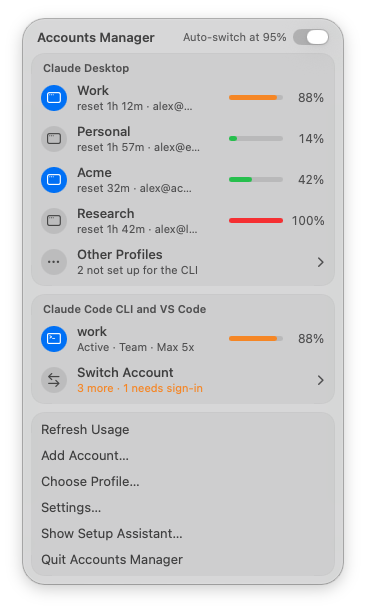
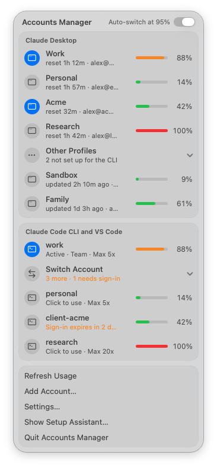
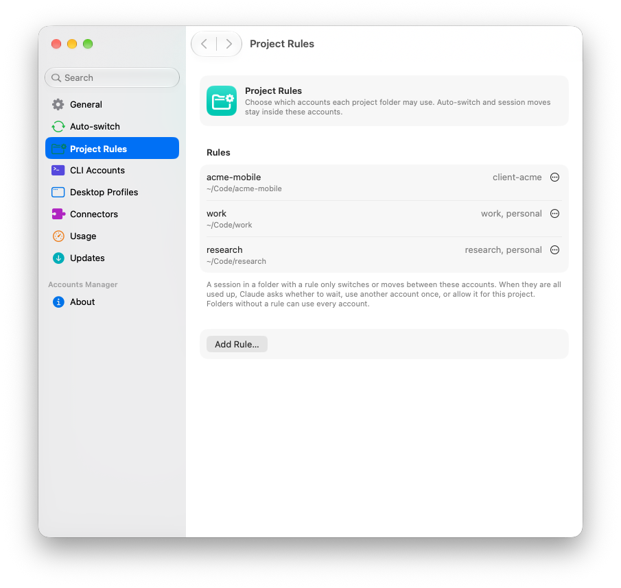
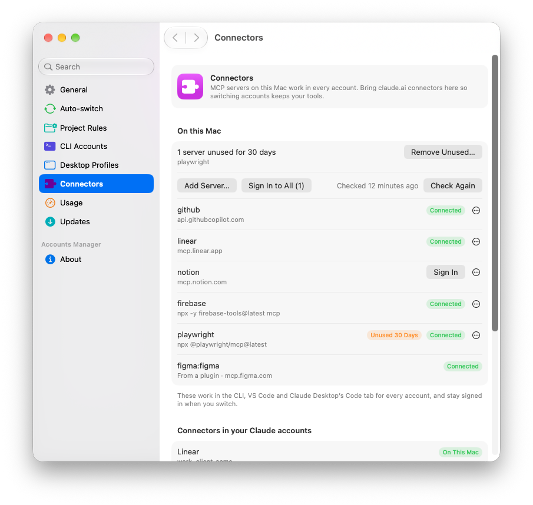
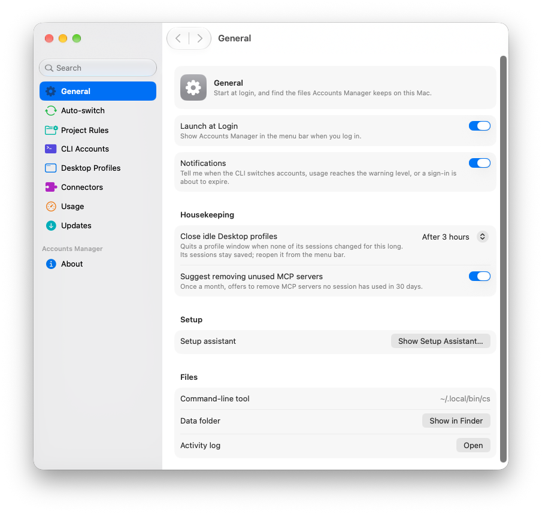
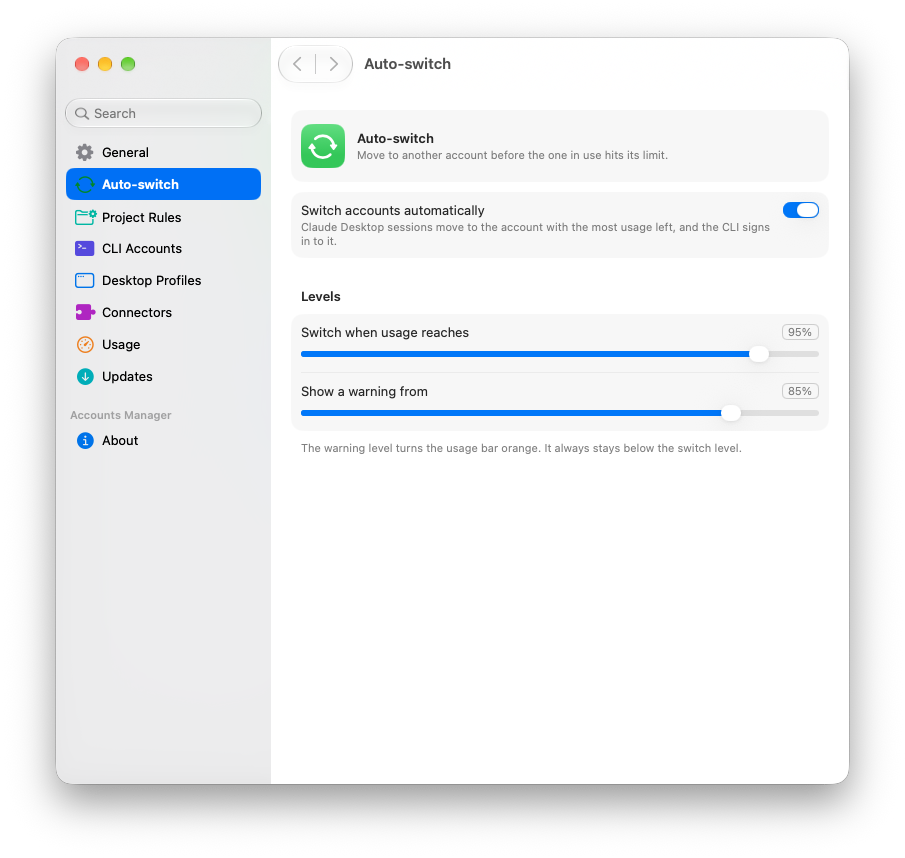
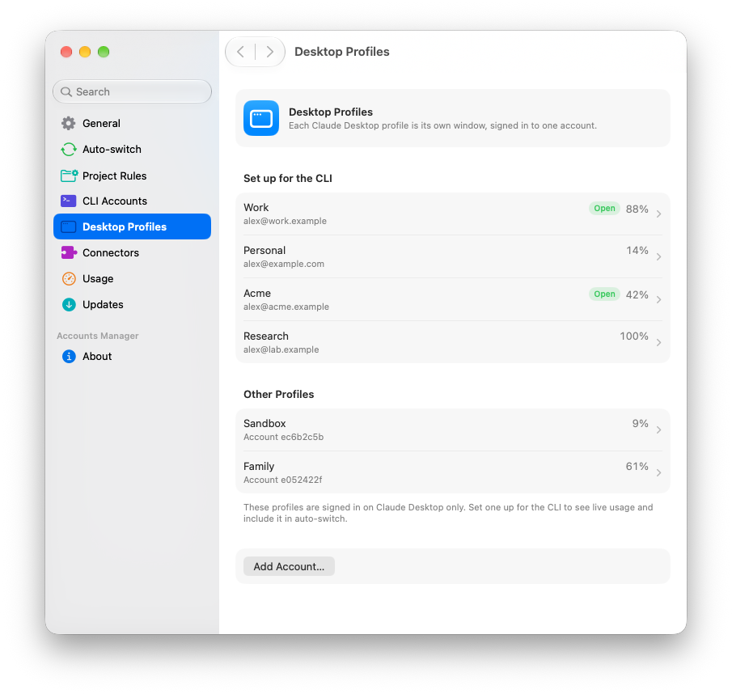

# Accounts Manager for Claude

Run several Claude accounts on one Mac, and keep working when one of them hits its limit.

[](https://github.com/NurFajarSA/claude-switch/actions/workflows/ci.yml)
[](LICENSE)


<p align="center">
  <picture>
    <source media="(prefers-color-scheme: dark)" srcset="docs/images/menu-bar-dark.png">
    
  </picture>
</p>

Accounts Manager for Claude is a menu bar app and a CLI (`cs`) for Claude Desktop, Claude Code and the Claude Code extension in VS Code. It shows the 5-hour and weekly usage of every account. Before an account runs out, it moves your work to the account with the most usage left. MCP servers, settings and session history stay the same after a switch.

> [!NOTE]
> Unofficial. It relies on how Claude Code and Claude Desktop store data on disk today, which can change in any release. Check the [Anthropic terms](https://www.anthropic.com/legal/consumer-terms) that apply to your accounts before using several of them.

## Why

A long agent run on one subscription stops when that subscription reaches its 5-hour or weekly limit. If you have more than one account, continuing means logging out, logging in to the other account, and finding the session again. On the CLI, that also disconnects every MCP server. Accounts Manager for Claude does the move for you. It switches the CLI login in the Keychain without touching MCP tokens, and it copies a Claude Desktop session into another account's profile window with its full transcript.

## Features

**Menu bar app**
- One row per Claude Desktop profile and per CLI account, each with a usage bar and its reset time.
- The CLI section shows the account in use. The other accounts sit behind **Switch Account**, sorted by usage left.
- Click a Desktop row to open or focus that window. Right-click a row to rename it, sign in again, or move a recent session into it.
- A Settings window in the System Settings style, and a setup assistant on first run.
- Notifications when the CLI account switches, when an account crosses the warning level, and when a sign-in has three days or less left.

**Claude Desktop**
- Every profile is a folder under `~/Library/Application Support/Claude-<name>` with its own signed-in account. Several profiles can be open at once.
- Move a Code session to another profile and keep the whole transcript.
- After a Claude Desktop update, every profile that was open is reopened, not only the default one.

**Claude Code CLI and VS Code**
- Auto-switch at a threshold you choose (95% by default). Running sessions pick up the new login within about 30 seconds.
- A rate-limit failure (`StopFailure`) triggers the switch immediately.
- Logins for the other accounts are parked in the Keychain and refreshed in the background.

**MCP connectors**
- MCP servers on this Mac work in every account and stay signed in across switches.
- Import claude.ai connectors that have a public URL, so they work in every account.

**Project rules**
- Limit a project folder to certain accounts. Auto-switch and session moves only pick allowed accounts.

**Housekeeping**
- Quits Claude Desktop profiles that have been idle for 3 hours.
- Suggests removing MCP servers that were not used for 30 days.

## Use cases

### A long agent run reaches the limit

You start a refactor in the terminal on `work`. At 95%, the hook switches the CLI login to the account with the most usage left before your next prompt. The session continues in the same terminal with the same MCP servers. A notification says which account took over.

The same happens in Claude Desktop. The hook copies the session to the profile with the most usage left, preferring a profile whose window is closed, and opens that window. Claude answers the current message and tells you to continue there.

### Several Desktop profiles open at once



You keep one Claude Desktop window per account. The panel shows how much each one has left, so you can see which window to use next. To move a session, right-click the target profile and choose **Move Session Here**, or ask Claude to call `handoff_session`.

A window only reads its session list at startup. A session moved into a window that is already open appears after that window restarts, and `cs handoff --restart` does the restart for you.

<br clear="right">

### Client work stays on the client's account



`~/Clients/Acme` may only use the account Acme pays for. Add a project rule in **Settings › Project Rules**, or run `cs rules set ~/Clients/Acme acme`. If you send a prompt there while the CLI is on another account, it switches to `acme` first. When every allowed account is used up, Claude asks you to choose:

- Wait for the reset.
- Use another account just this once.
- Allow that account for the project from now on.

### Connectors are shared across accounts



You connected Figma, Notion and Linear on claude.ai with one account. **Settings › Connectors › Import All** adds the ones with a public URL to this Mac, so every account uses them. Servers that need a sign-in get a **Sign In** button.

### Idle profiles close themselves



A Desktop window left open overnight can use more than 1 GB of memory. After 3 hours without session changes, the background service quits it, and a notification offers **Open Again**. It never quits the window in front, or a window opened within the last 3 hours. Sessions stay saved.

## Install

Requirements: macOS 15 or later on Apple silicon, and the [Claude Code CLI](https://docs.anthropic.com/en/docs/claude-code).

### Install script (recommended)

```bash
curl -fsSL https://raw.githubusercontent.com/NurFajarSA/claude-switch/main/install.sh | sh
```

The script downloads the latest release, checks it against its published SHA-256, and runs `cs install`, which sets up everything in the table under [From source](#from-source). Set `ACCOUNTS_MANAGER_VERSION=1.0.0` to pick a version. Read [`install.sh`](install.sh) first if you prefer; it is short.

### From a release

Releases are ad-hoc signed, not notarized: the project has no Apple Developer ID yet. macOS puts a quarantine flag on anything a browser downloads, and for an app without a Developer ID it blocks the app and kills the bundled `cs` without a message. The install script avoids this because `curl` sets no flag. To install a release you downloaded in a browser:

1. Download `AccountsManager-<version>-macos-arm64.zip` from [Releases](https://github.com/NurFajarSA/claude-switch/releases) and check it with the `.sha256` next to it.
2. Unzip it, then clear the flag and install:

```bash
xattr -dr com.apple.quarantine "Accounts Manager for Claude.app"
"Accounts Manager for Claude.app/Contents/Resources/cs" install --app "Accounts Manager for Claude.app"
```

`cs install` copies the app to `~/Applications`. If you'd rather approve it by hand, open the app once, then choose **Open Anyway** in System Settings › Privacy & Security; that covers the app but not the `cs` it installs, so the `xattr` step is still needed. Releases also include a standalone `cs-<version>-macos-arm64.tar.gz`.

### With Homebrew

```bash
brew install --cask nurfajarsa/tap/accounts-manager-for-claude
cs install --app "/Applications/Accounts Manager for Claude.app"
```

The cask links `cs` into your `PATH` and clears the quarantine flag after installing. It lives in a separate tap repository, `NurFajarSA/homebrew-tap`, which has to exist before this works. Copy `packaging/homebrew/accounts-manager-for-claude.rb` to `Casks/accounts-manager-for-claude.rb` there. After a release is packaged, `scripts/update-cask.sh <version>` fills in the version and checksum.

### From source

Requirements: [Bun](https://bun.sh) 1.3 or later, and Xcode 16 or later (Swift 6).

```bash
git clone https://github.com/NurFajarSA/claude-switch.git
cd claude-switch
bun install
bun run install:local
```

`install:local` builds `cs` and the app, then installs:

| What | Where |
| --- | --- |
| `cs` binary | `~/.local/bin/cs` |
| Background usage poller | LaunchAgent `app.claude-switch.daemon` |
| Menu bar app | `~/Applications/Accounts Manager for Claude.app`, opens at login |
| MCP server `claude-switch` | Claude Code user scope (`claude mcp add --scope user`) |
| Hooks on `UserPromptSubmit` and `StopFailure` | `~/.claude/settings.json`, after a backup next to it |

`cs install` also removes an older `Claude Accounts.app` from `~/Applications`.

## Quick start

Add each account once. One command sets it up for both Claude Desktop and the CLI:

```bash
cs register          # the account the CLI is logged in with now
cs add work          # opens a new Desktop profile "work"; sign in there, then approve the CLI login in the browser
cs add personal
cs status
```

`cs add` creates the Desktop profile and waits for you to sign in to it. Then it runs the CLI login and checks that both use the same account. The CLI keeps the account it had before. The browser step signs in with whatever claude.ai account the browser uses, so open the printed link in a private window when the browser is on a different account.

If a Desktop profile for the account already exists, `cs link <profile>` adds only the CLI side. The menu bar has the same actions: **Add Account…**, and **Set Up for CLI…** on a profile under **Other Profiles**.

### Logins expire after about 28 days

Measured on Claude Code 2.1, a CLI login lasts about 28 days from sign-in, and refreshing it does not extend that. Desktop profile logins also last about 28 days, and opening the profile appears to extend them. The app shows the days left and warns 5 days ahead. To renew a CLI login, run `cs relogin <alias>` or choose **Sign In Again…** in the menu bar. Open each Desktop profile now and then to keep it signed in.

## Configure



**Settings…** in the menu bar opens the Settings window. Each setting also has a `cs config` key:

| Key | Default | Meaning |
| --- | --- | --- |
| `autoSwitch` | `true` | Switch or move automatically when an account reaches the threshold |
| `threshold` | `95` | Usage percentage that triggers a switch |
| `warnAt` | `85` | Usage percentage that posts a warning notification |
| `pollSeconds` | `300` | How often the background service checks usage |
| `idleCloseHours` | `3` | Quit Desktop profiles idle this long; `0` turns it off |
| `mcpCleanup` | `true` | Suggest removing MCP servers unused for 30 days |



Every CLI account and Desktop profile has its own page with usage, sign-in expiry, rename and sign-in actions. Renaming a Desktop profile only changes its display name. The profile folder keeps its name.

## Project rules

A rule maps a folder to the accounts it may use. The deepest matching folder wins. Folders without a rule can use every account. Set rules in **Settings › Project Rules**, or with `cs rules`.

- **CLI and VS Code.** If a project's rule does not include the signed-in account, the CLI switches to an allowed account before the prompt runs. Auto-switch only picks allowed accounts.
- **Claude Desktop.** If a session's window belongs to an account the project does not allow, Claude says so once and offers to move the session. Automatic moves only go to allowed profiles.
- **All accounts used up.** Claude offers to wait for the reset, use another account once, or allow that account for the project (`cs rules allow <folder> <account>`).
- **MCP tools.** The tools follow the same rule. `ignore_project_rule` makes a one-off exception, and `allow_account_for_project` adds an account to the rule.

## Connectors

**Settings › Connectors** lists two groups:

- The MCP servers on this Mac. Every account uses them, and they stay signed in across switches.
- The claude.ai connectors each of your accounts has.

Connectors with a public URL, such as Figma, Notion, Google and Linear, can be added to this Mac one at a time or all at once. Sign in to each once with `/mcp`, or with the **Sign In** button. The button opens Terminal and runs `claude mcp login` there, because some sign-ins ask you to paste a redirect URL.

Some connectors only work inside claude.ai:

- Anthropic-hosted connectors, such as Claude Docs and visualize.
- Connectors whose sign-in accepts only claude.ai. This was seen with GitHub, Slack, Asana, Box and HubSpot.

Import adds each server and checks it. If the server's sign-in rejects other apps, import removes it again with a note, so the claude.ai copy keeps working. Claude Code hides a claude.ai or plugin copy of a server that has the same URL as one on this Mac (seen in `claude mcp list` on Claude Code 2.1), so tools are not listed twice.

## Housekeeping

Every 5 minutes, the background service quits Claude Desktop profiles whose sessions have not changed for 3 hours. It never quits the window in front, or one opened within that time. Sessions stay saved, and a notification offers **Open Again**.

Once a day, it reads Claude Code transcripts to see which MCP servers are used. At most once a month, it offers to remove servers unused for 30 days.

Change or turn off both in **Settings › General › Housekeeping**, or with `cs config idleCloseHours <hours|0>` and `cs config mcpCleanup false`. `cs events` lists what the service did on its own.

## Use it from an agent

`cs install` registers an MCP server named `claude-switch`, which gives Claude these tools:

| Tool | What it does |
| --- | --- |
| `list_accounts` | Lists every profile and account with its usage and the project rule |
| `handoff_session` | Moves the current Desktop conversation to the account with the most usage left, or to a named profile, and opens that window |
| `switch_cli_account` | Changes the CLI and VS Code login |
| `allow_account_for_project` | Adds an account to the current project's rule |

## CLI reference

| Command | What it does |
| --- | --- |
| `cs status [--refresh] [--json]` | Usage for every Desktop profile and CLI account |
| `cs doctor [--json]` | Checks that the Keychain, Anthropic endpoints, Claude Desktop and the install match what `cs` expects |
| `cs add <name> [--cli-only \| --desktop-only]` | Adds an account to Claude Desktop and the CLI |
| `cs link <profile> [--as alias]` | Signs the CLI in to the account a Desktop profile uses |
| `cs register [alias]` | Registers the account the CLI uses now |
| `cs relogin <alias>` | Signs in to a CLI account again before its login expires |
| `cs switch <alias\|email> \| --auto` | Changes the CLI and VS Code login |
| `cs sessions [profile] [--limit n] [--json]` | Lists recent Claude Desktop Code sessions |
| `cs handoff <session-id> [--to profile] [--restart] [--no-open]` | Moves a Desktop session to another profile |
| `cs open <profile>` | Opens or focuses a Desktop window |
| `cs new-profile <name>` | Creates a Desktop profile and opens it to sign in |
| `cs label <profile> <label> \| --clear` | Sets a display name for a Desktop profile |
| `cs update-desktop` | Installs a downloaded Claude Desktop update and reopens every open profile |
| `cs rename <alias> <new-alias>` | Renames a CLI account |
| `cs remove <alias>` | Forgets an account and deletes its stored login |
| `cs config [key] [value]` | Shows or changes settings |
| `cs rules [list] \| set \| allow \| remove` | Manages project rules |
| `cs connectors [list [--check] \| import \| add \| remove \| login \| logout]` | Manages MCP servers and claude.ai connectors |
| `cs events [--since <time>] [--json]` | Lists what the background service did on its own |
| `cs login-item [on\|off]` | Shows or changes whether the app opens at login |
| `cs poll` | Fetches usage for every account once |
| `cs statusline` | Prints a one-line summary for a Claude Code status line |
| `cs install [--app path]` / `cs uninstall` | Installs or removes the binary, poller, MCP server, hooks and app |

`cs help` prints the full usage of every command.

## How it works

The Claude Code CLI keeps one login in the Keychain item `Claude Code-credentials`. The same item holds the OAuth tokens of your MCP servers. A switch replaces only the `claudeAiOauth` part, so MCP connections survive it. Claude Code rereads the item every 30 seconds, so running sessions pick up the switch without a restart.

Refresh tokens rotate, so two programs that refresh the same account would log each other out. Each account therefore has exactly one owner. Claude Code owns the live account. `cs` owns every parked account, stored in the Keychain service `claude-switch`, and refreshes it in the background.

Claude Desktop keeps one signed-in account per profile folder, started with `--user-data-dir`. Each Code session is a small card in `claude-code-sessions/<account>/<org>/local_<id>.json` that points to a transcript in `~/.claude/projects/`. Every profile shares the transcripts. Moving a session copies its card into the other profile, so nothing is exported or replayed.

Usage comes from the endpoint Claude Code uses for `/usage`. [docs/architecture.md](docs/architecture.md) covers the switch sequence, crash recovery and the Desktop internals.

## Limits

- A Claude Desktop window reads its session list only when it starts. A session moved into an open window appears after you quit it (Cmd+Q) and reopen it. `cs handoff --restart` and the menu bar app can do that for you. Automatic moves prefer a profile whose window is closed for this reason.
- If the source window is still open, the moved session stays in both sidebars. Keep working in only one of them.
- Connectors added on claude.ai belong to that account. After a move, the session uses the new account's claude.ai connectors. MCP servers added on this Mac (`claude mcp add --scope user`) work the same in every account.
- The usage endpoint is undocumented and may change. Run `cs doctor` after a Claude Code or Claude Desktop update. It prints one line per check and exits with code 1 when something is broken.

## Privacy and security

- Logins stay in the macOS Keychain. `cs` never writes a token to a file or a log.
- The only network calls go to Anthropic: the usage, profile and token refresh endpoints that Claude Code itself uses.
- There is no telemetry and no account on any server of this project.
- State lives in `~/.config/claude-switch/`, and the log is `~/.config/claude-switch/claude-switch.log`.

Report vulnerabilities as described in [SECURITY.md](SECURITY.md).

## Uninstall

```bash
cs uninstall
```

This removes the binary, the background service, the MCP server, the hooks and the app. Stored logins stay in the Keychain under the service `claude-switch` until you run `cs remove <alias>` for each account.

## Development

```bash
bun install
bun run check                # typecheck and tests
CI_NO_KEYCHAIN=1 bun test    # skips test/keychain-e2e.test.ts, which uses throwaway items in the real macOS Keychain
bun src/cli.ts status
./macos/build-app.sh         # builds dist/Accounts Manager for Claude.app
```

The app reads these environment variables at launch:

| Variable | Effect |
| --- | --- |
| `CLAUDE_SWITCH_BIN=<path>` | Runs this `cs` instead of the installed one |
| `ACCOUNTS_MANAGER_SNAPSHOT=<file.png>` | Renders the menu bar panel to a PNG and exits |
| `ACCOUNTS_MANAGER_SNAPSHOT_DARK=1` | Renders the snapshot in dark mode |
| `ACCOUNTS_MANAGER_SNAPSHOT_OTHERS=1` | Expands **Other Profiles** and **Switch Account** in the snapshot or preview |
| `ACCOUNTS_MANAGER_PREVIEW_PANEL=1` | Shows the menu bar panel in a floating window, for screenshots |
| `ACCOUNTS_MANAGER_APPEARANCE=light\|dark` | Forces the app's appearance |
| `ACCOUNTS_MANAGER_OPEN_SETTINGS=1` | Opens the Settings window at launch; add `-settingsPane rules` (or another pane) to pick the page |
| `ACCOUNTS_MANAGER_OPEN_ONBOARDING=1` | Opens the setup assistant at launch |

The screenshots in `docs/images` come from anonymised fixtures in `scripts/demo`, served by a stand-in `cs`. To regenerate them after a UI change, build the app and run:

```bash
scripts/screenshots.sh
```

The script runs the app under a throwaway home folder, so it never reads your accounts or changes your preferences. It needs Screen Recording permission for the terminal you run it from.

### Releasing

The version lives in `package.json`. It feeds `cs --version`, the MCP server and the app's `Info.plist`. To release:

1. Bump the version in `package.json`.
2. Move the `CHANGELOG.md` entries under the new version.
3. Push a tag `v<version>`.

The `Release` workflow runs the tests, runs `scripts/package-release.sh` on a macOS 26 runner (the SDK the app links against decides its look), and publishes the zip and tarball with their checksums. `install.sh` picks up the new release as soon as it is published. Run the script locally to get the same files in `dist/release/`, and test the install script against them with `ACCOUNTS_MANAGER_BASE_URL=file://$PWD/dist/release sh install.sh`.

Signing is optional. Set `DEVELOPER_ID_APP` to a codesign identity to sign with the hardened runtime. To notarize and staple, also set `NOTARY_PROFILE` (a `notarytool` keychain profile), or set `APPLE_ID`, `APPLE_TEAM_ID` and `APPLE_APP_PASSWORD`. In CI, the secrets `MACOS_CERT_P12_BASE64` and `MACOS_CERT_PASSWORD` enable signing, and the three `APPLE_*` secrets enable notarization. Without them, the release is ad-hoc signed.

## Contributing

Issues and pull requests are welcome. Read [CONTRIBUTING.md](CONTRIBUTING.md) first, and run `bun run check` before you open a pull request.

## License

[MIT](LICENSE)

Accounts Manager for Claude is an independent project. It is not affiliated with, endorsed by, or sponsored by Anthropic. Claude is a trademark of Anthropic, PBC.
